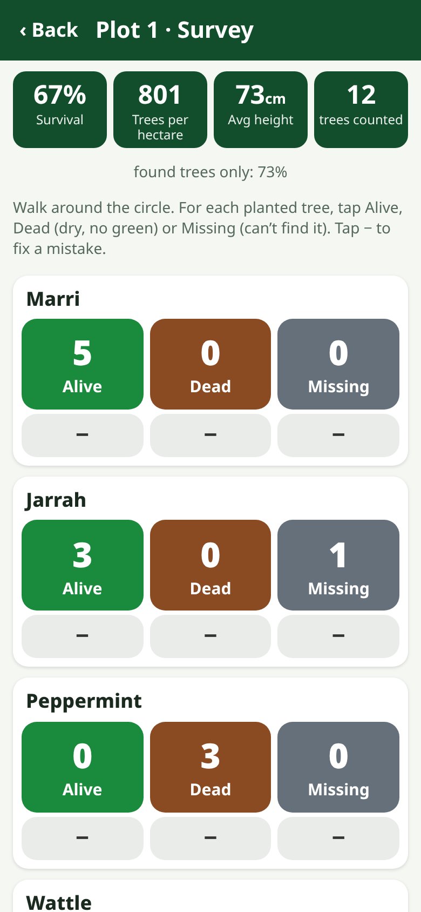

# Planting Survey

A **free** phone app for checking how your tree planting is going: how many trees **survive**, how many **trees per hectare** you have, how fast they **grow**, and **photo points** to see change year by year.

Made for anyone, anywhere — landcare groups, schools, kids, villages and small reforestation / carbon projects. Plain language, works on cheap Android phones, **works offline after the first load**, no account, no server, no adverts.

**Open the app:** https://johnrichardszpe-dot.github.io/planting-survey/
(Then use your browser menu → *Add to Home screen* / *Install app*.)

By **John Richards**. Version 0.1.0.

## How to use (plain English)
1. **New site** — type the site name, the planting date, the kinds of trees you planted and how many you planted.
2. **New plot** — pick a typical spot (not the best or worst bit). Hammer in a **stake** — that's the plot centre. Stand on it and tap **Get GPS**. Choose a circle size: a **5.64 m** rope makes a **100 m²** circle, **7.98 m** makes **200 m²**. Make 3 or more plots spread over the site.
3. **Start a survey** — tie the rope to the stake and walk it round. For every planted tree inside the circle tap **Alive**, **Dead** or **Missing**. If you can, **measure** a few living trees (height, stem thickness, health).
4. **Photo point** — stand at the stake, face the same way as last time (the app shows the old photo faded over the camera and tells you which way to turn), and take a photo.
5. **Come back** each year in the **same season** and do it again. The chart shows survival % and average height over time. **Find this plot** points you back to the stake.
6. **Export CSV** (opens in any spreadsheet) or make a **Backup file** often — your data is only on your phone.

## Features (v0.1)
- Sites: name, planting date, species list, number planted, optional site size (ha), notes.
- Fixed-radius circular plots: 2 m (12.6 m²), 3.99 m (50 m²), 5.64 m (100 m²), 7.98 m (200 m²) or any radius. GPS centre with accuracy (best fix kept while you wait), step-by-step help for marking the centre with a stake, and **Find this plot** (distance + compass arrow back to the centre).
- Survey: big tap counters per species for **Alive / Dead / Missing** with − to undo; optional per-tree height (cm), stem diameter (mm, at base or at 1.3 m = DBH) and health (good / stressed). Live totals: **survival %**, **trees per hectare**, **average height**, plus survival of found trees only.
- Permanent photo point: rear camera, compressed JPEG (max 1280 px, quality 0.7) stored in IndexedDB on the phone, with date and compass bearing. The last photo is shown as an adjustable **ghost overlay** and the app says "turn left/right n°" to match the old bearing. Falls back to the phone's own camera/file picker.
- Repeat surveys per plot; SVG chart of survival % and mean height over visits (no chart library).
- Site summary pooled over the latest survey of each plot; estimated living trees on the site if the site size is given.
- Export: **CSV** (one row per species × status count, plus one row per measured tree; site, plot, GPS, accuracy, radius, area, date in UTC and local time with offset, survival %, stems/ha), **shareable summary text** (phone share sheet or copy), **backup / restore JSON** (photos optional).
- All words in one place (`strings.js`) ready for translation; English included.
- Installable PWA, offline cache with versioned service worker.

## Methods
| Quantity | How it is worked out |
|---|---|
| Plot area | π × radius² (5.64 m → 99.9 m²; 7.98 m → 200.1 m²) |
| Survival % | alive ÷ (alive + dead + missing) × 100. Missing trees count as *not* surviving (cautious). "Found trees only" = alive ÷ (alive + dead) is also shown, because a missing tree may turn up later. |
| Trees per hectare | alive trees in plot ÷ plot area (m²) × 10 000 |
| Site figures | pooled over the latest survey of each plot: Σ alive ÷ Σ counted; Σ alive ÷ Σ area × 10 000; × site hectares for estimated living trees |
| Height | ground (root collar) to the highest living shoot tip, in cm |
| Stem diameter | mm, just above the soil (root collar) for young trees; at 1.3 m (DBH) once trees are big enough — the CSV records which |
| Find plot | great-circle (haversine) distance and initial bearing from your GPS to the saved centre |

Why these choices (from the sources below):
- **Fixed plots revisited over time** and survival counts by species against what was planted are the standard simple method for revegetation (Revegetation Guide ch. 8; SA Landscape Boards *Recording success*; NSW BCT guidelines). IndiKit / FAO-style guidance: random or representative plots of **at least 100 m²**, marked with durable poles, GPS recorded, survival = surviving ÷ planted × 100, cover each type of ground (wet/dry, slope, near grazing) — hence the 100 m² default and the "3 or more plots" advice.
- **Missing ≠ dead**: FORRU records "not found" separately and warns not to assume death; a tree that looks dead may resprout. So the app keeps Dead and Missing apart and shows both survival figures.
- **Timing**: survey 1–2 weeks after planting (baseline), at 3–6 months, then yearly at the **same season** (end of the wet season in seasonal climates); the 18–24 month survey is the key one (FAO SFM Toolbox, FORRU). Avoid deciding "dead" in the dry season for deciduous species.
- **Height and stem diameter** (root-collar diameter, later DBH/girth) are the standard growth measures; a simple health score (good / stressed) follows FORRU's simplified health scoring.
- **Photo points**: same spot (marked with a post), same direction, same season each year, record date, direction and GPS, take the previous photo with you to frame the new one (Revegetation Guide ch. 8; Landcare Tasmania; USDA NRCS photo-point guide) — that is what the ghost overlay and saved bearing do.
- Existing tools (Restor, Plant-for-the-Planet TreeMapper, FAO Open Foris Ground / Collect) are powerful but need accounts, set-up or servers. Planting Survey aims at the simplest possible no-account, offline, one-phone version; its CSV can be moved into those tools or a spreadsheet.

### Sources
- Revegetation Guide (Australia), Ch. 8 *Keeping Track: Monitoring Your Site* — https://revegetation.org.au/?page_id=994
- Landcare Tasmania, *Photo monitoring your restoration project* — https://www.landcaretas.org.au/photo_monitoring_your_restoration_project_2
- Green Adelaide / SA Landscape Boards, *Revegetation – recording success* — https://cdn.environment.sa.gov.au/landscape/docs/lc/202112_-_revegetation_-_recording_success.pdf
- NSW Biodiversity Conservation Trust, *Restoring native vegetation guidelines* (2020) — https://revegetation.org.au/wp-content/uploads/2024/08/restoring-native-vegetation-guidelines-nov-2020.pdf
- USDA NRCS, *Quick guide to photo point monitoring* — https://efotg.sc.egov.usda.gov/references/public/NM/bio61a6_PhotoDocumentation_Protocol.pdf
- FAO Sustainable Forest Management Toolbox, *Forest restoration* (monitoring & maintenance timetable) — https://www.fao.org/sustainable-forest-management-toolbox/modules/forest-restoration/en
- FAO, *Herramientas para la comunidad* — survival surveys and sample-size rule of thumb — https://www.fao.org/4/x9996s/X9996S05.htm
- IndiKit, *Proportion of surviving seedlings* — https://irw.indikit.net/indicator/4417-proportion-of-surviving-seedlings
- FORRU (Chiang Mai Univ.), *Field performance of planted trees* and *Species selection* — https://www.forru.org/advice/field-performance-planted-trees , https://www.forru.org/advice/species-selection
- Haase (2008), *Understanding forest seedling quality: measurements and interpretation*, Tree Planters' Notes 52(2) — https://rngr.net/publications/tpn/52-2/understanding-forest-seedling-quality-measurements-and-interpretation-1/at_download/file
- Restor — https://restor.eco ; TreeMapper — https://www.plant-for-the-planet.org/treemapper/ ; Open Foris Ground — https://www.openforis.org/ground/ ; Open Foris Collect — https://www.openforis.org/collect/

## Honest limits
- **Data lives only on this phone** (browser storage). Clearing browser data, uninstalling, or losing the phone loses it. **Export CSV / Backup often.** The app asks the browser for persistent storage, but cannot guarantee it.
- **Phone GPS is often 5–15 m out** (worse under trees or in gullies). Always mark the plot centre with a real stake; GPS just gets you close.
- **Phone compasses** can be 10°+ out and are upset by vehicles, fences and steel; bearings on iPhones are approximate. Some phones have no compass.
- Plots are a **sample**: site-wide survival, trees/ha and "estimated living trees" are estimates, only as good as the number and spread of plots. No confidence intervals yet.
- No slope correction for plot radius (on steep ground, measure the rope level).
- Counts natural regeneration only if you tap it — the app counts whatever you decide is "a planted tree" in the circle.
- Photos are compressed for storage; for high-quality archives also use the phone camera.
- v0.1 has English only; translations welcome (`strings.js`).

## For developers
Plain HTML/CSS/JS, no build step, no libraries. `index.html`, `style.css`, `strings.js` (all text), `logic.js` (maths, CSV — shared with tests), `app.js` (UI, IndexedDB), `sw.js` (offline cache — **bump `CACHE` on every change**), `manifest.webmanifest`, `icons/`. Tests: `node test.js`. Compass maths reused from the sibling app [Tree Gauge](https://github.com/johnrichardszpe-dot/tree-gauge).

## Licence
Free to use. ## More free tools by John Richards
- 🌲 [Tree Gauge](https://johnrichardszpe-dot.github.io/tree-gauge/) — forest basal area with the phone camera (angle-gauge method)
- 🌱 [Planting Survey](https://johnrichardszpe-dot.github.io/planting-survey/) — seedling survival %, trees per hectare and photo points *(this app)*
- 🔥 [Fuel Check](https://johnrichardszpe-dot.github.io/fuel-check/) — simple step-by-step bushfire fuel hazard check
- 🧭 [Forest Explorer](https://johnrichardszpe-dot.github.io/forest-explorer/) — school forest science kit: height, trunk, carbon
- 🦜 [Habitat Survey](https://johnrichardszpe-dot.github.io/habitat-survey/) — habitat trees, hollows, wildlife sightings and signs
- 🍎 [Orchard Counter](https://johnrichardszpe-dot.github.io/orchard-counter/) — row-by-row tree counts, gaps, replant list, yield sample
- 🚧 [Roadside Trees](https://johnrichardszpe-dot.github.io/roadside-trees/) — roadside and powerline tree hazards, trimming and work lists
- 🌌 [Universe map](https://johnrichardszpe-dot.github.io/universe-map/) — explore John Richards' map of the universe

The same list is in the app (About / More tools screen), from the shared `more-tools.js`.

No licence file chosen yet — all rights reserved by John Richards until one is added.
